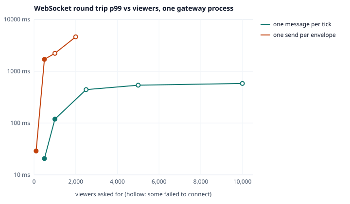
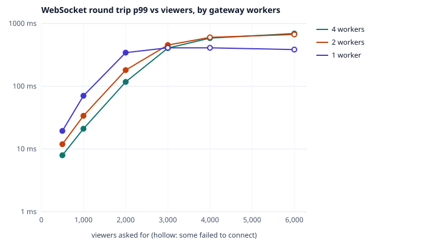

# Performance

What was measured, how, and where it stops. Every number below comes from a CI run on a
GitHub-hosted runner, with the raw results committed in [`bench/results/`](../bench/results/);
nothing is estimated. Where a target from the build plan was missed, it says so.

## Hardware and method

- **Machine:** GitHub Actions `ubuntu-latest`, 4 vCPUs, 16 GB. The load tests run the **whole
  stack** (NATS, TimescaleDB, Prometheus, Grafana, the simulator, the paper trader, analytics,
  the gateway) **and the load generator on the same 4 CPUs**. That is pessimistic for the
  gateway and makes the numbers comparable run to run, not a peak.
- **Latency** is recorded in HdrHistograms (0.1% resolution, exact maximum). Round trips are
  corrected for coordinated omission: when a ping is late, the pings that couldn't be sent
  during the stall are counted too, so a stall weighs in p99 as it really did.
- **Load model:** open. `bench/wsload` (Go) connects viewers at a constant arrival rate,
  whether or not earlier connections finished, up to each step, then holds the step and
  measures. Each viewer reads everything it is sent, pings every second, and records how old
  each book update is when it arrives (staleness, against the gateway's send stamp) and how
  long trades took from the bus.
- **Feed:** the simulated venue (BTC-SIM): about 40 limit, 4 market and many cancel orders a
  second through the C++ matching engine, plus analytics and the paper trader's state, about
  55 envelopes a second per viewer.

## Before and after

| | Original app (`v0-baseline`) | Now |
| --- | ---: | ---: |
| Messages to each viewer | 6,277/s, every tick | ≤ 20/s (one per 50 ms tick), every envelope delivered |
| Viewers on one server, all connected, round trip p99 | p99 over 100 ms by 50 viewers | **1,000 at 21 ms, 2,000 at 117 ms** (4 gateway workers); up to 4,173 connected |
| Book updates per second, one core | ~39k ticks/s through Python + Redis | **32.4M/s** in the C++ book alone |
| Order matching | none | **9.4M actions/s** (C++ engine) |
| Book correctness | random levels | Kraken CRC32-verified books, Binance sequence-verified, golden replay hashes |

The original numbers are in [`baseline.md`](../bench/results/baseline.md) and the C++ numbers
in [`cpp.md`](../bench/results/cpp.md).

## Viewers on one gateway



Full ramp on main ([`wsload.csv`](../bench/results/wsload.csv)), 30 s per step, connections
opened at 500 a second:

| Viewers asked for | Connected | Failed to connect | Messages/s per viewer | Envelopes/s per viewer | Round trip p50 / p99 / max | Staleness p50 / p99 / max | Trade bus → viewer p50 / p99 |
| ---: | ---: | ---: | ---: | ---: | --- | --- | --- |
| 500 | 500 | 0 | 17.9 | 58.2 | 0.2 / 20.6 / 103 ms | 9.7 / 22.5 / 104 ms | 39 / 76 ms |
| 1,000 | 1,000 | 0 | 16.2 | 55.3 | 5.0 / 119 / 205 ms | 19.7 / 133 / 200 ms | 54 / 194 ms |
| 2,500 | 1,953 | 547 | 10.3 | 51.5 | 144 / 442 / 527 ms | 52 / 320 / 366 ms | 176 / 484 ms |
| 5,000 | 2,133 | 2,320 | 8.4 | 44.0 | 183 / 538 / 641 ms | 64 / 387 / 447 ms | 228 / 596 ms |
| 10,000 | 2,133 | 2,479 | 8.3 | 43.2 | 186 / 581 / 685 ms | 65 / 405 / 443 ms | 218 / 590 ms |

The first version of the gateway sent each envelope as its own WebSocket message
([`wsload-per-envelope.csv`](../bench/results/wsload-per-envelope.csv)): 500 viewers already
had a round trip p99 of 1.7 s and 1,000 could not all connect. Sending each viewer one
message per tick, built once and shared by every viewer of the symbol (ADR 002), moved the
knee from under 500 viewers to about 2,000.

## Several gateway processes

`--workers N` runs N gateway processes on one port (`SO_REUSEPORT`, so the kernel spreads new
connections across them), each with its own bus subscription and mirrors. Three runs on the same
commit, started together on three runners ([`wsload-workers-1.csv`](../bench/results/wsload-workers-1.csv),
[`-2`](../bench/results/wsload-workers-2.csv), [`-4`](../bench/results/wsload-workers-4.csv)):



| Workers | Most viewers all connected | Round trip p99 at 1,000 | at 2,000 | at 3,000 | Most connected |
| ---: | ---: | ---: | ---: | ---: | ---: |
| 1 | 2,000 | 70.5 ms | 344 ms | n/a | 2,192 |
| 2 | 3,000 | 33.8 ms | 181 ms | 454 ms | 3,754 |
| 4 | 3,000 | **21.0 ms** | **117 ms** | 406 ms | **4,173** |

Four workers cut p99 at 1,000 viewers by more than three times and nearly double how many
connect. It is less than linear because the four workers share the runner's 4 vCPUs with the load
generator (several thousand connections of its own), NATS and the rest of the stack: past two
workers they are competing for the same cores as their clients. The same runs put the
single-worker knee between 2,000 and 2,500 viewers, as before, so runs are comparable.

## Where it breaks, and why

- **One Python event loop per worker.** Each gateway worker is a single asyncio process. Each tick it appends one
  message to every viewer's queue and each viewer's task writes it to its socket: at about
  2,000 viewers that is some 35,000 socket writes a second, and the loop saturates. Past
  that, the WebSocket handshakes of new viewers time out (the "failed to connect" column) and
  everyone's latency rises together, since the loop is shared. The 1,000-viewer p99 varies
  between runs (52 ms on a 20 s step, 119 ms on this 30 s step after a faster ramp), which is
  what a loop near its limit looks like.
- **The load generator shares the CPUs.** Thousands of Go client goroutines, Docker, NATS and
  the other services run on the same 4 vCPUs, so these are lower bounds for a dedicated server.
- **The target was 10,000 viewers at p99 < 50 ms. That was not reached.** With four workers
  it is about 1,000 viewers at p99 under 50 ms and 4,000 connected at all, on a 4-vCPU runner
  that also runs the load generator. Measuring a dedicated server with the clients on another
  machine is the next honest step; after that, writing to sockets without a task per viewer, or
  moving fan-out into a compiled server.
- **Staleness is bounded below by the tick**: book updates wait up to 50 ms for the next tick
  by design (the `gateway_hold` hop: p50 39 ms, max 67 ms when unloaded).

## Latency per hop

From the services' own `/metrics` (`md_latency_ms`), in the integration job: a 2,199-message
Kraken recording replayed onto the bus as fast as possible, so this is a burst, not steady
state.

| Hop | p50 | p99 | max |
| --- | ---: | ---: | ---: |
| bus → gateway | 6.2 ms | 153 ms | 158 ms |
| gateway hold (conflation) | 38.6 ms | 51.2 ms | 66.7 ms |

Under the full load test the same hops rose to p50 93 ms / p99 454 ms (bus → gateway) as the
gateway's loop saturated: the bus and the producers stayed fast, which places the limit in
the gateway. The Grafana dashboard shows every hop live, including venue → ingest (which
includes the venue clock's offset) and ingest → bus.

## From Python to C++

| Benchmark (one core) | Throughput |
| --- | ---: |
| `L2Book` apply, C++ only | 32.4M updates/s |
| Kraken checksum | 1.05M/s |
| `MatchingEngine`, 70% limit / 10% market / 20% cancel | 9.4M actions/s |
| Python reference book (`PyBook`) on recorded Kraken updates | 13.4M updates/s |
| C++ book called from Python per message | 5.6M updates/s (0.4×) |

Called from Python one message at a time, the C++ book is slower than the Python dict-based
one: crossing into C++ costs more than a dict update. The gain needs whole loops in C++, which
is how the simulator uses the engine (ADR 004).

## Reproducing

```bash
# The load test, on any machine with Docker and Go (raise limits first for thousands of viewers)
docker compose up -d --build --wait
cd bench/wsload && go run . -url ws://localhost:8080/ws/sim/BTC-SIM -steps 500,1000,2500 -hold 30s -csv ../results/wsload.csv
python scripts/plot_load.py bench/results/wsload.svg "now=bench/results/wsload.csv"

# Or on a GitHub runner: Actions → bench-load → Run workflow (steps, hold, rate)
```
