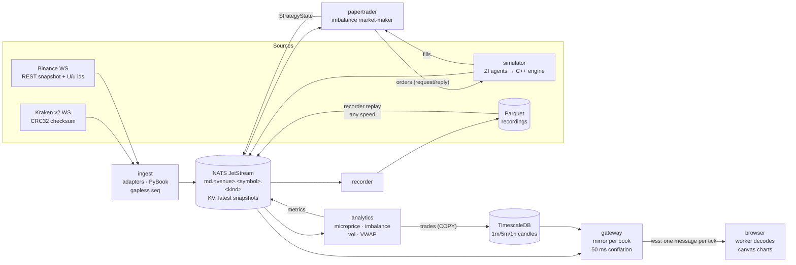
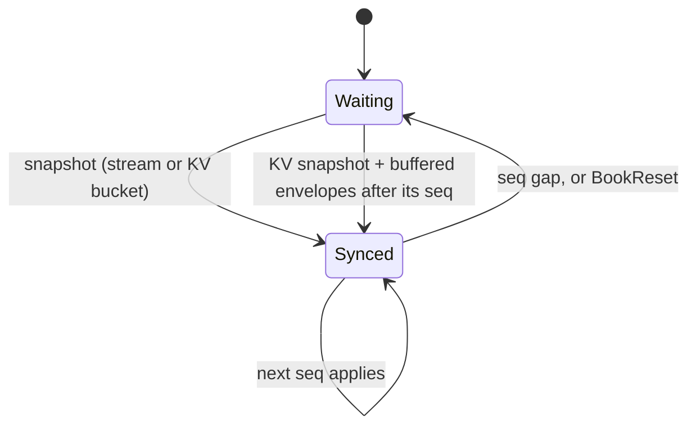
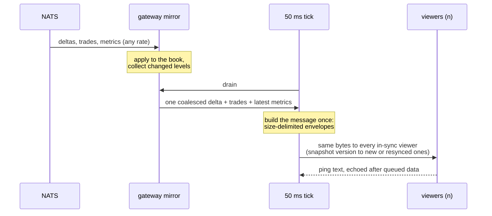
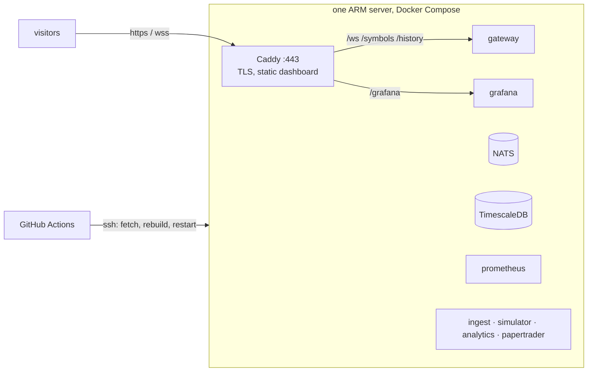

# Architecture

Live order books from real venues and a simulated one, normalized into one schema, carried
over a bus, enriched, stored, and served to browsers through a conflating gateway. Decisions
and their alternatives are in [`adr/`](adr/); measured numbers are in
[`PERFORMANCE.md`](PERFORMANCE.md).

## The pipeline

| Service | Role | Code |
| --- | --- | --- |
| ingest | One adapter per venue: connect, subscribe, keep a reference book, verify (Kraken CRC32, Binance update ids), publish snapshots, deltas, trades and resets with a gapless seq | `services/ingest` |
| simulator | A venue of its own: zero-intelligence agents around a random-walk fair value, matched by the C++ engine; takes outside orders | `services/simulator`, `core/` |
| analytics | Mirrors every book; publishes microstructure metrics; stores trades | `services/analytics` |
| recorder | Writes every envelope to hourly Parquet; replays them | `services/recorder` |
| papertrader | Market-makes the simulated venue with risk limits; publishes its PnL | `services/papertrader` |
| gateway | One bus subscription, a mirror per book, conflated fan-out, candle history | `services/gateway` |
| web | Worker decodes and keeps state; panels read one view per animation frame | `web/` |

## Keeping books correct

Every consumer of a book follows the same protocol as a venue's own feed.

- Ingest assigns a gapless `seq` per venue and symbol to every book and trade envelope. A venue
  checksum mismatch or sequence gap makes the adapter emit `BookReset` and resubscribe.
- About once a second ingest writes each in-sync book to the `snap` KV bucket, tagged with the
  seq of the last envelope it includes. A consumer that joins late or sees a gap loads it and
  applies the buffered envelopes after that seq.
- Consumers read book and trade envelopes on **one** subscription (`md.*.*.*`): NATS runs each
  subscription's callbacks independently, so two subscriptions would reorder them.
- Golden replay hashes (`ingest/tests/golden/`) pin the books each recording must produce,
  through ingest, through Parquet and through the bus.

## Fan-out to browsers

- At most one message per viewer per tick (20/s) whatever the feed rate; trades are never
  dropped while a viewer keeps up.
- A viewer whose queue (100 messages, about 5 s) fills loses its backlog and gets a fresh
  snapshot; one still behind 5 s later is closed with code 1013.

## Observability

Every hop is timed from the envelope's own timestamps into HdrHistograms (`mdcommon.latency`)
and exported on `/metrics` with counters for envelopes, resets, viewers, frames and resyncs.
Prometheus scrapes them and Grafana shows the **Market data pipeline** dashboard, both
provisioned from `deploy/`. Alerts: checksum failures, gateway lag, a service down.

## Deployment

Only Caddy is published. See [`DEPLOY.md`](DEPLOY.md).
